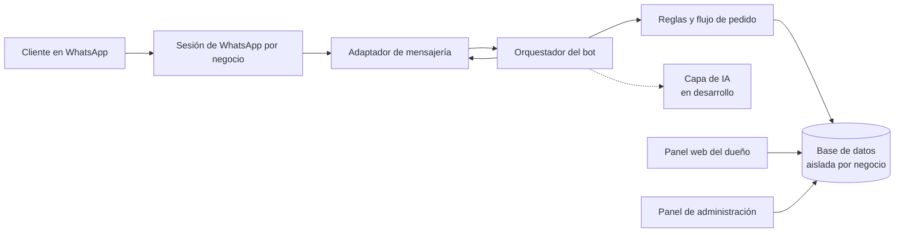
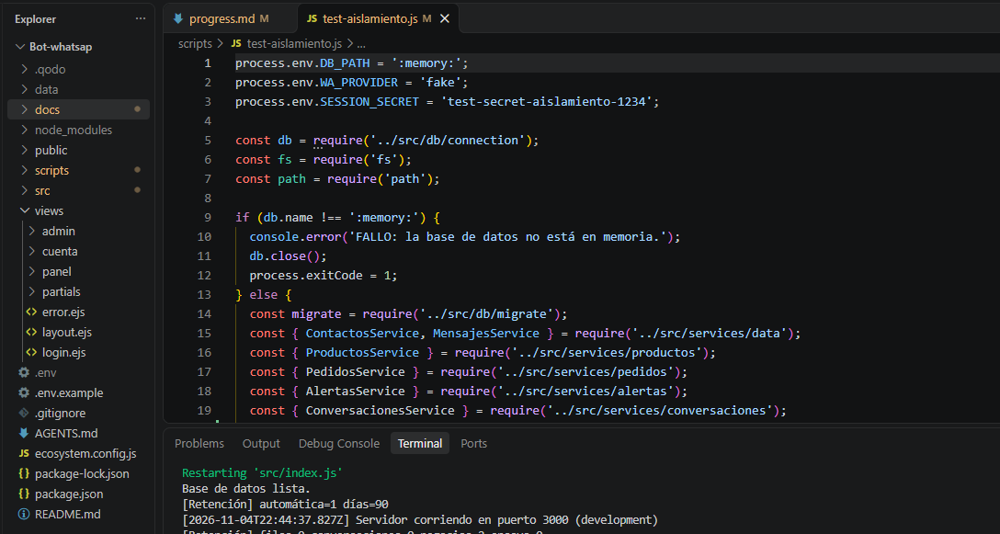
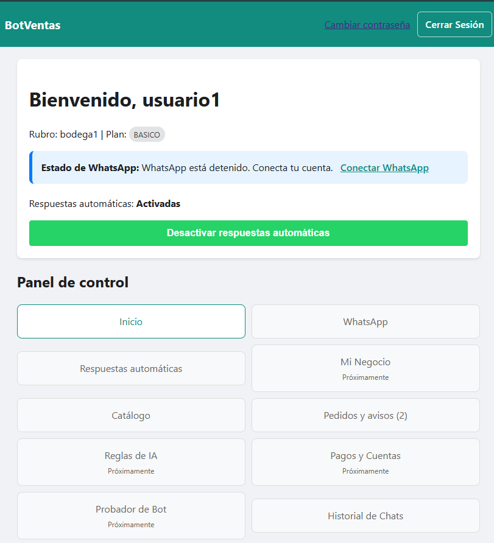
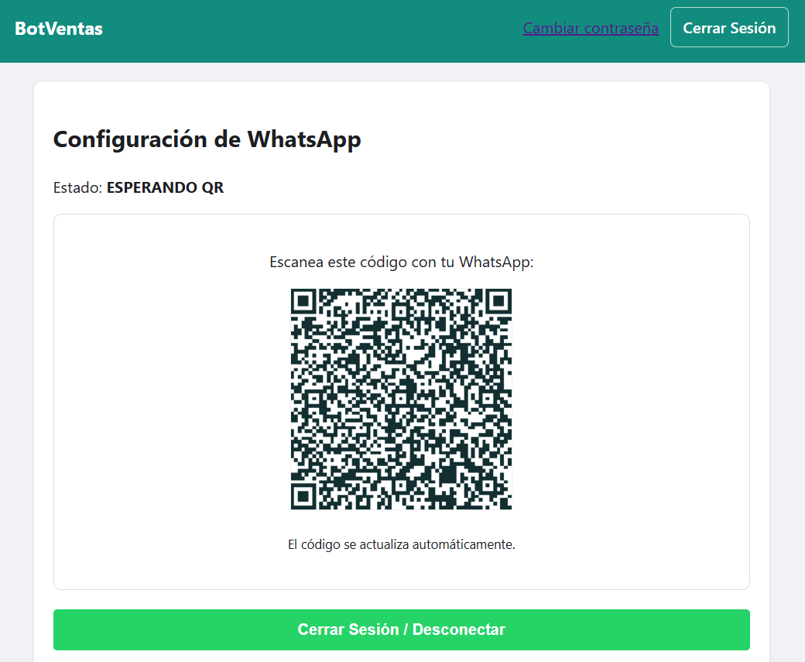
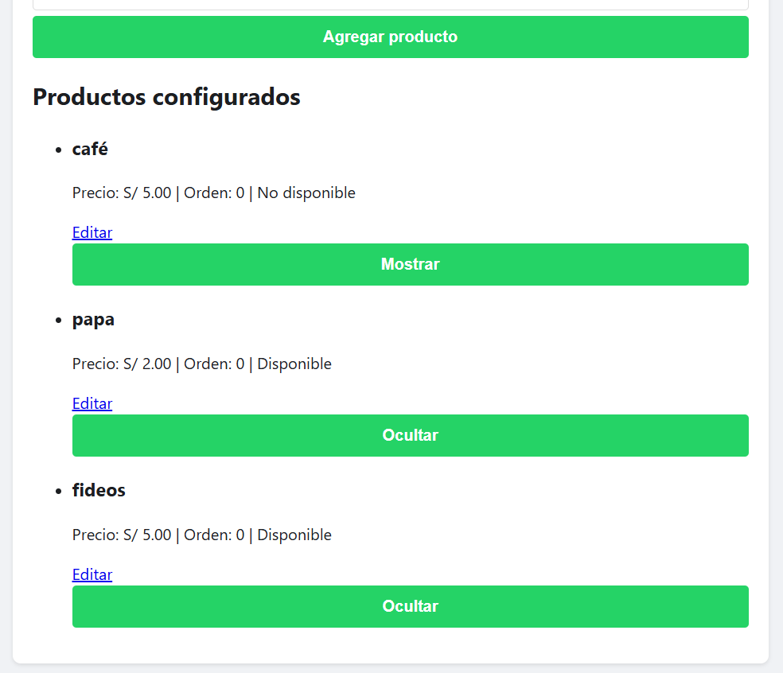
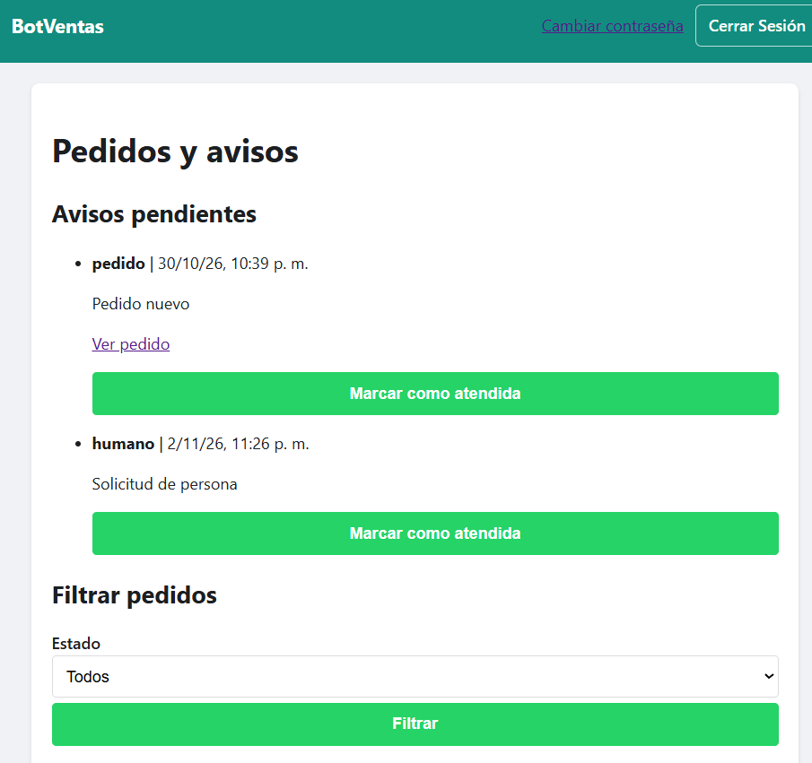
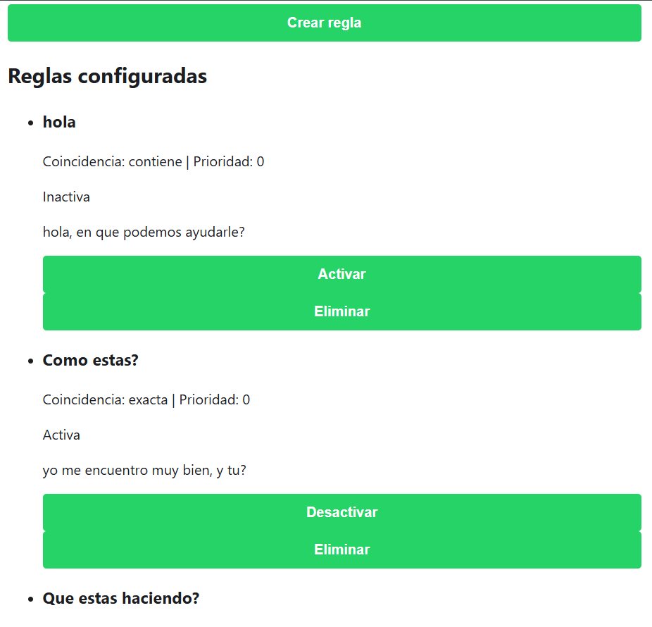
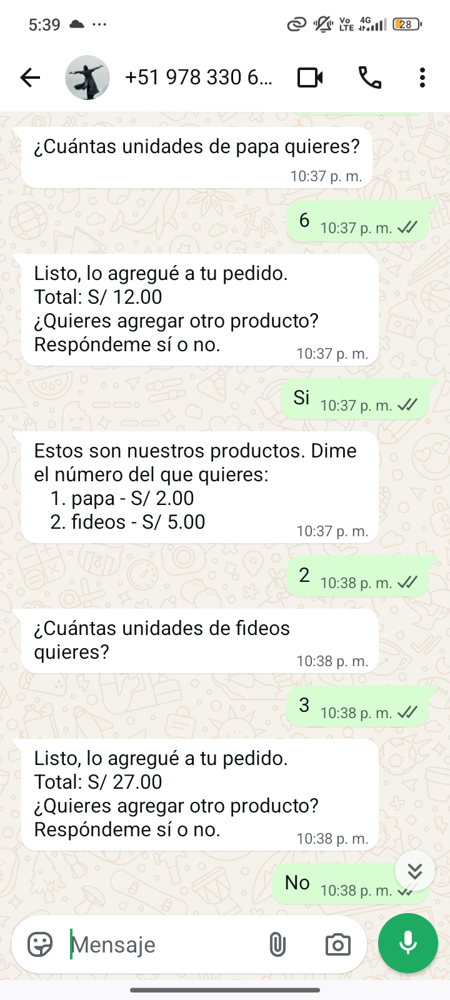
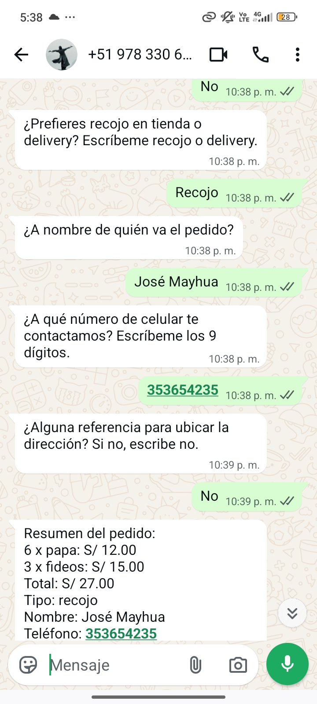

# SaaS Multi-negocio de Bots de WhatsApp

SaaS multi-negocio que atiende a los clientes de tiendas pequeñas de Perú por WhatsApp, con un panel web para que cada dueño gestione su negocio.

**Versión:** [v4] · **Última actualización:** 4 de noviembre de 2026

> Código fuente privado. Este repositorio contiene solo documentación. AL FINAL SE ENCUENTRAN LAS CAPTURAS DEL PROYECTO

## El problema

Bodegas, estéticas y bazares venden por WhatsApp. El dueño responde mensajes a mano, toma pedidos en conversaciones largas y pierde ventas cuando no puede contestar. Las herramientas existentes suelen ser caras o pensadas para empresas grandes.

## La solución

Un solo servidor atiende a varios negocios (multi-tenant). Cada negocio tiene:

- su propio número de WhatsApp vinculado,
- su panel web,
- sus datos aislados de los demás.

El bot responde a quien le escribe primero, muestra el catálogo y guía al cliente hasta registrar un pedido. El dueño revisa los pedidos y avisos desde el panel.

**Principio de diseño:** el código decide los precios, totales y pedidos; la IA (en desarrollo) solo conversa. El dueño confirma los pagos, nunca la IA.

## Funcionalidades

### Disponibles (probadas manualmente)

- Alta de negocios y cuentas desde un panel de administración, con cambio obligatorio de contraseña en el primer ingreso.
- Panel de cliente con estado de la conexión de WhatsApp en tiempo real.
- Vinculación de WhatsApp por código QR, restauración de la sesión sin volver a escanear y cierre ordenado.
- Recepción y almacenamiento de mensajes (texto, imagen, audio y sticker) y pantalla de consulta.
- Respuesta manual del dueño desde el panel.
- Respuestas automáticas por reglas configurables por el dueño.
- Catálogo de productos con panel de gestión y respuesta del bot.
- Pedidos por WhatsApp: flujo guiado (productos, cantidades, datos de entrega y confirmación).
- Panel de pedidos y avisos para el dueño, con cambio de estado y notas internas.
- Baja y alta de contactos, y derivación a una persona con pausa del bot.
- Privacidad: anonimización de contactos y retención limitada de mensajes.

### En desarrollo

- **Asistente conversacional con IA.** Existe un módulo con proveedor simulado, validación de salida y límites de uso. Aún no está conectado al bot real ni a un proveedor de IA.
- Panel de configuración del negocio y del comportamiento de la IA (la base de datos ya está preparada).
- Probador de bot para ensayar conversaciones sin enviar mensajes reales (el núcleo de decisión ya está separado; falta la pantalla).

### Planificado

- Descuentos con tope definido por el dueño.
- Verificación de pagos con confirmación del dueño.
- Alertas al WhatsApp personal del dueño.
- Historial y métricas.

## Arquitectura

- Cada negocio tiene su propia sesión de WhatsApp y su identidad de tenant.
- La mensajería está detrás de un adaptador, con un proveedor simulado para pruebas.
- La lógica de decisión del bot es independiente del envío y de la base de datos, lo que permite probarla sin efectos reales.

## Stack tecnológico

| Tecnología | Uso |
|---|---|
| Node.js + Express | Servidor y rutas |
| EJS | Vistas del panel |
| SQLite | Base de datos y almacén de sesiones web |
| WPPConnect | Conexión con WhatsApp Web |
| bcryptjs | Almacenamiento seguro de contraseñas |
| Helmet | Cabeceras de seguridad y política CSP estricta |
| express-rate-limit | Límites de peticiones |

## Decisiones técnicas

1. **Aislamiento entre negocios.** *Elegí:* un identificador de negocio en cada tabla, tomado siempre de la sesión del usuario y nunca de datos enviados por el cliente, y pruebas automáticas que verifican que un negocio no ve datos de otro. *Descarté:* una base de datos por negocio, por el costo de mantenimiento a esta escala.
2. **SQLite.** *Elegí:* SQLite por simplicidad de despliegue y bajo costo con pocos negocios. *Descarté:* un motor cliente-servidor por ahora; la migración queda como posibilidad si crece la carga.
3. **WhatsApp detrás de un adaptador.** *Elegí:* aislar la librería de mensajería con un proveedor real y uno simulado. *Por qué:* permite probar sin abrir WhatsApp y cambiar de librería. *Riesgo asumido:* WPPConnect no es oficial y el número puede sufrir restricciones; documento este riesgo y mitigo con ritmo de envío moderado, pausas y derivación a una persona. Evaluar la API oficial es parte del roadmap.
4. **La IA redacta, el código decide.** *Elegí:* que precios, totales, pedidos y pagos nunca los calcule el modelo, sino herramientas del sistema con validación posterior de la respuesta. *Descarté:* dejar que el modelo gestione el pedido completo, por el riesgo de errores e inventos.
5. **Bot determinista como base.** *Elegí:* construir primero reglas y un flujo guiado probados con WhatsApp real, y montar la IA encima, detrás de un interruptor apagado por defecto. *Por qué:* permite apagar la IA sin perder lo ya funcional.

## Seguridad

Enfoque a nivel de concepto:

- Autenticación con contraseñas almacenadas con hash y política de longitud mínima.
- Cambio de contraseña obligatorio para cuentas nuevas o restablecidas.
- Control de acceso por rol (administrador y cliente) y por negocio.
- Protección contra CSRF en formularios y política de contenido estricta (sin scripts ni estilos inline).
- Validación de toda entrada en el servidor.
- Límites de peticiones y bloqueo de intentos de acceso repetidos.
- Sesiones del servidor, cierre de sesión seguro y expiración.
- Registros sin contenido de mensajes ni datos personales.
- Los datos de sesión de WhatsApp y las credenciales nunca se versionan ni se sirven por HTTP.

## Calidad y pruebas

- Un comando único de verificación ejecuta toda la batería y debe terminar sin fallos antes de dar una tarea por cerrada. En la última ejecución documentada (3 de noviembre de 2026) reportó 100 comprobaciones superadas.
- Pruebas de: vistas, ciclo de vida de WhatsApp con proveedor simulado, rutas HTTP y permisos, aislamiento entre negocios, migraciones de base de datos (incluida la reversión ante errores), flujo de pedido, módulo de IA con proveedor simulado y privacidad de los registros.
- Hay verificaciones manuales con WhatsApp real y dos negocios de prueba documentadas por fase.

## Capturas de pantalla
*Estructura del codigo fuente el proyecto.*

*Inicio del panel del dueño: estado de WhatsApp y accesos principales.*

*Pantalla de vinculación con código QR de demostración.*

*Lista de productos con precio y disponibilidad (datos de ejemplo).*

*Listado de pedidos y detalle de un pedido de prueba.*

*Reglas de respuesta configurables.*

*Prueba en tiempo real 1.*

*Prueba en tiempo real 2.*

*Listado de negocios con su estado de WhatsApp (datos de ejemplo).*

## Roadmap

1. Panel de configuración del negocio y de la IA.
2. Integración de la IA con herramientas, detrás de un interruptor por negocio.
3. Probador de bot.
4. Descuentos con tope del dueño y verificación de pagos.
5. Alertas al WhatsApp personal del dueño.
6. Historial y métricas.
7. Revisión legal de privacidad (Ley 29733, Perú) y evaluación de la API oficial de WhatsApp antes de operar con clientes reales.

## Sobre mí y contacto

Jose Adolfo Mayhua Palomino · GitHub: [(https://github.com/J-Mayhua)] · Correo: [joseadolfomayhua01@gmail.com]

## Licencia

Código fuente privado. Todos los derechos reservados. Este repositorio contiene solo documentación del proyecto.
